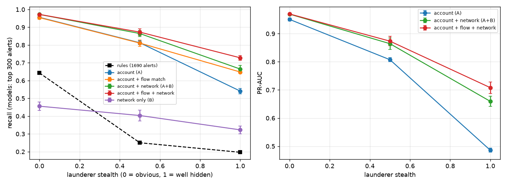
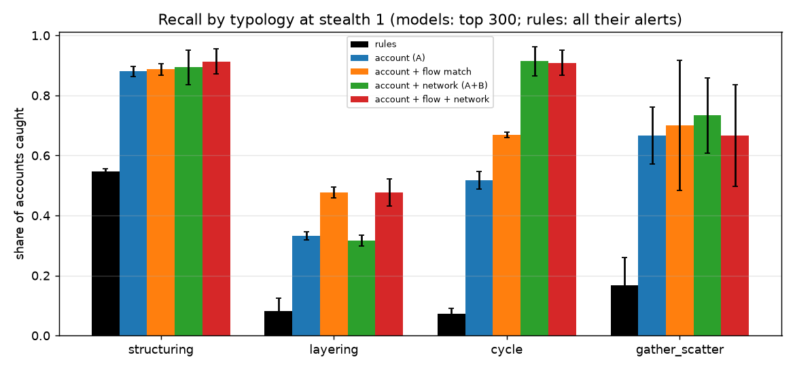
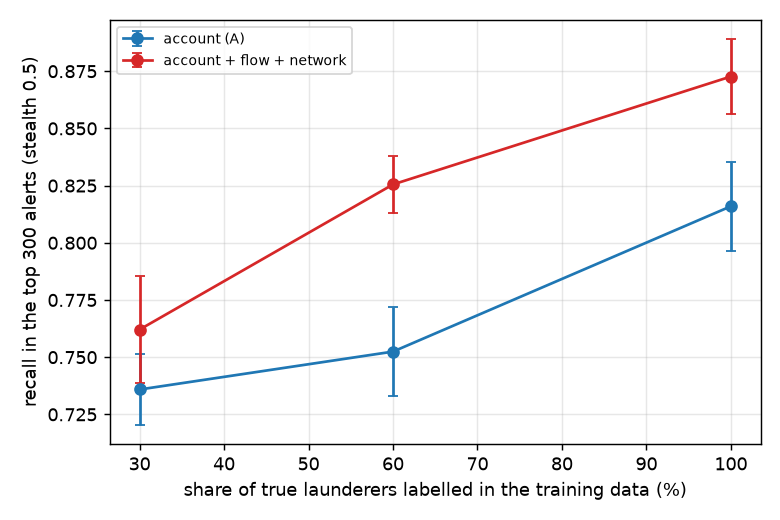

# Anti-Money-Laundering Transaction Monitoring: Rules vs. Account Models vs. Network Features

Banks must find laundering inside millions of ordinary payments. Today most of them run **threshold rules** that bury investigators in false alarms. This project builds a synthetic bank and asks, on a bank the models have never seen: **how much better is machine learning than rules, and when does looking at the *network* of payments (who sends to whom) add something that account-level behaviour cannot?**



## The synthetic bank

30,000 accounts and about 330,000 payments over 60 days.

- **Four laundering typologies** (about 200 positive accounts, 0.7%): *structuring* (cash deposits just under the 10,000 reporting threshold, then one transfer out), *layering* (money hops through a chain of mule accounts), *cycles* (A → B → C → A with shrinking amounts) and *gather-scatter* (many payers → hub → many receivers).
- **Benign look-alikes that trip naive rules**: payroll runs, payment processors that forward 98% of what they receive, merchants with many payers, cash-intensive shops, friends splitting a bill in a triangle.
- **Stealth** (0 to 1) controls how well launderers hide: at 0 they move large, obvious sums (median about 35,000); at 1 the laundered amounts look like an ordinary small-business account (median about 2,500), hops are slower, and structured deposits are no longer all just under the threshold.
- Everything is synthetic. Models are trained on one simulated bank and tested on another (3 repetitions, mean ± std).

## Features

| Group | What it holds |
|---|---|
| **Account behaviour (A)** | Counts and amounts in and out, cash deposits and how many sit just under the threshold, distinct counterparties, concentration, share of incoming money forwarded within two days |
| **Flow match** | Large incoming transfers followed within 15 days by an outgoing one of 85-100% of the amount: a conservation-of-money signature that does not depend on timing |
| **Network (B)** | Triangle count, membership in a strongly connected group of large transfers (money going round in circles), PageRank, and how many of an account's counterparties are fast pass-through accounts |

Rules: five thresholds, one per typology (≥ 3 deposits of 8,000-9,999; ≥ 50,000 cash; ≥ 85% forwarded with ≥ 20,000 throughput; ≥ 15 payers and ≥ 5 receivers; any single transfer ≥ 30,000).

## Results

Models: gradient boosting, **top 300 alerts** (1% of accounts, a realistic review budget; maximum possible precision about 0.67). Rules: every alert they raise (about 1,690).

| Recall | Stealth 0 (obvious) | Stealth 0.5 | Stealth 1 (well hidden) |
|---|---|---|---|
| Rules (≈ 1,690 alerts) | 0.64 | 0.25 | **0.20** |
| Account behaviour (A) | 0.96 | 0.81 | 0.54 |
| A + flow match | 0.95 | 0.81 | 0.65 |
| A + network (B) | 0.97 | 0.86 | 0.66 |
| **A + flow + network** | **0.97** | **0.87** | **0.73** |
| Network only (B) | 0.46 | 0.40 | 0.32 |

Precision of the queue: rules 7.8% → 2.5% as stealth rises; models 65% → 37-50% (A vs A + flow + network at stealth 1).

- **Rules fall apart when launderers adapt**: recall 0.64 → 0.20 and precision down to 2.5%, because the thresholds are exactly what smaller amounts evade. At stealth 0.5 their alert queues (summed over the 3 repetitions) hold **2,654 cash-intensive shops and 1,785 ordinary accounts** next to only about 150 of the roughly 600 real launderers.
- **When launderers are obvious, the network adds almost nothing**: +1 to +2 recall points at stealth 0 (paired, per repetition: +0.010, +0.015, +0.025). Account behaviour already tells them apart.
- **As they hide, the network is worth more** and the gain is consistent in every repetition: **+4 to +7 points at stealth 0.5** and **+11 to +13 at stealth 1**.
- **Different typologies need different evidence** (stealth 1):



| Recall at stealth 1 | Structuring | Layering | Cycle | Gather-scatter |
|---|---|---|---|---|
| Rules | 0.55 | 0.08 | 0.07 | 0.17 |
| Account (A) | 0.88 | 0.33 | 0.52 | 0.67 |
| A + flow match | 0.89 | **0.48** | 0.67 | 0.70 |
| A + network | 0.89 | 0.32 | **0.91** | 0.73 |
| A + flow + network | 0.91 | **0.48** | **0.91** | 0.67 |

**Cycles are the network's win** (0.52 → 0.91): a strongly connected group of large transfers is a structural fact no single account shows. **Chains of mules are not**: network features do nothing for layering (0.33 → 0.32), while the account-level flow-match feature helps (0.48). Layering remains the weakest typology for everyone, and gather-scatter barely improves with any addition.

### Only caught launderers are labelled

Training labels come from past investigations, so many launderers sit in the data as "negatives". Keeping only a share of the true positives as labels (stealth 0.5, recall in the top 300):

| Labelled share of launderers | 100% | 60% | 30% |
|---|---|---|---|
| Account (A) | 0.82 | 0.75 | 0.74 |
| A + flow + network | 0.87 | 0.83 | 0.76 |

Missing labels cost about 7-8 points of recall for the account model and 11 for the richest model; the network advantage shrinks from 5 points to 2 when only 30% of cases are labelled. Positive-unlabelled learning would be the natural next step.



## What went wrong on the way (and was fixed)

- **First version: saturated.** With obvious launderers, an account-level model caught 95% at a 1% budget and the network added 1 point, which would have read as "graph features do not matter". It was only an easy benchmark.
- **My first "stealth" backfired.** I made mules look more ordinary by adding more extra payments to them; recall *rose* to 1.00 because accounts with abnormal activity volume stood out more. Hiding means laundering with amounts that fit the account, so stealth was redefined that way, and the sweep is reported in full rather than one favourable level.
- A column called "recall at the rules' volume" was computing precision; fixed.

## Limitations

- A simulation with four clean typologies; real laundering is messier, evolves against detection, and its ground truth is partly unknown.
- The feature thresholds (large = 1,500, cash-near-threshold = 8,000-9,999) are fixed and tuned by hand, not learned.
- Evaluation uses a 1% review budget and recall of labelled accounts; real programmes weigh case severity, investigation cost and regulatory reporting, none of which is modelled.
- Gradient boosting with default settings; graph neural networks and sequence models are not compared, and PageRank is the only global network measure.
- Labels are per account; real alerts are often per case or per customer relationship.

## Project structure

```
src/aml/
  sim.py        # accounts, ordinary payments, benign look-alikes, four typologies, stealth parameter
  features.py   # account behaviour, flow match, network features (triangles, strongly connected groups, PageRank, neighbours)
  rules.py      # the five threshold rules a classic monitoring system runs
  evaluate.py   # stealth sweep, typology breakdown, false-positive composition, label coverage, figures
tests/          # 6 tests: simulator, stealth, features on hand-built networks, rules, alert arithmetic, end-to-end vs rules
```

## Quickstart

```bash
python -m venv .venv && source .venv/bin/activate
pip install -r requirements.txt
PYTHONPATH=src python -m aml.evaluate    # about 7 minutes
pytest
```

## Tech stack

Python · NumPy · pandas · SciPy (sparse graphs) · scikit-learn · Matplotlib · pytest

---

### 🇹🇷 Türkçe özet

Kara para aklama izlemede **kurallar mı, hesap bazlı model mi, yoksa ödeme ağı özellikleri mi?** Sentetik bir bankada (30 bin hesap, 330 bin işlem; parçalama, katmanlama, döngü ve topla-dağıt tipolojileri, bordro/ödeme işlemcisi/nakit işletmesi gibi meşru taklitçiler) görülmemiş bir bankada test edildi. Aklayıcılar gizlendikçe **kurallar çöküyor** (geri çağırma %64 → %20, kesinlik %2,5; alarm kuyruğu nakit yoğun işletmelerle doluyor), hesap bazlı model %96 → %54 düşüyor, ağ özellikleri ise aklayıcılar belirginken neredeyse hiç katkı sağlamıyor (+1-2 puan) ama gizlendikçe değer katıyor (+4-7, sonra +11-13 puan, her tekrarda tutarlı). Tipolojiye göre kanıt farklı: **döngüleri ağ yakalıyor (0,52 → 0,91)**, katman zincirlerini ise ağ değil, hesap düzeyi "akış eşleşmesi" özelliği (0,33 → 0,48). Yol boyunca iki hata yakaladım: ilk kıyaslama doygundu ve ağ özelliklerini yararsız gösterecekti; ilk "gizlenme" tanımım ters tepip aklayıcıları daha belirgin yaptı. Veri sentetik.
